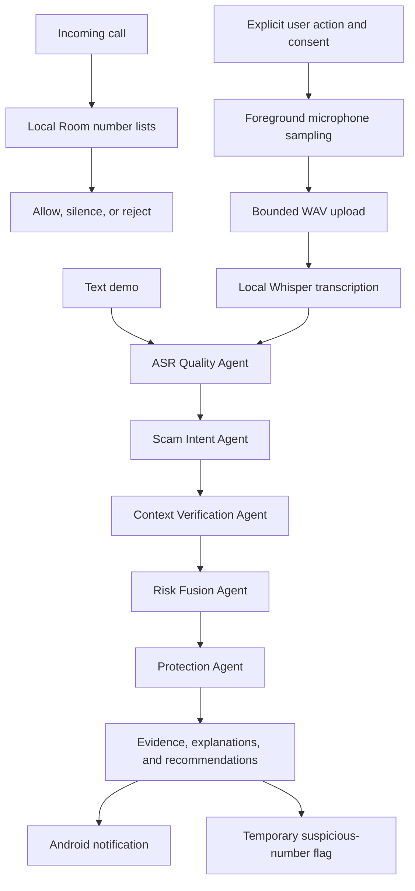

# Architecture and implementation boundaries

## Node responsibilities

| Node | Implementation | Boundary |
| --- | --- | --- |
| ASR Quality Agent | Detects empty transcripts and low confidence | Unknown confidence is not treated as known high confidence |
| Scam Intent Agent | Rule baseline; optional structured LLM inference | Exact transcript evidence is required for semantic findings |
| Context Verification Agent | Uses client-provided number-list context | Cannot authenticate a claimed bank, company, or agency |
| Risk Fusion Agent | Combines heuristic content and historical risk | Scores are not calibrated probabilities |
| Protection Agent | Generates recommendations and temporary feedback | Permanent blocking requires user confirmation |

The graph is sequential and deterministic by default. Node names describe responsibilities, not independent autonomous LLM agents. Only the optional semantic node uses an external model.

## Android boundaries

Local screening runs independently from microphone analysis. The screening service schedules a 1.5-second allow fallback before dispatching database work. Only exact normalized international numbers are matched; suffix matching cannot confer trust.

A trusted-number match overrides local block/suspicious flags, but a trusted context does not suppress suspicious content in the backend analysis. Automated content findings update only expiring suspicious flags and never overwrite a trusted entry. Low-risk segments do not clear earlier suspicion.

Audio capture is started manually from a visible activity, has a visible foreground notification, and is bounded to 60 seconds. If phone-state access is granted, the service can stop on an idle transition after observing an off-hook state. It cannot guarantee capture of both call participants.

## Backend boundaries

SQLite stores anonymous call IDs, number-context flags, transcripts, and results. Raw phone numbers are not part of the call-init contract. Audio files are temporary and are removed after processing; abnormal process termination may leave temporary files requiring cleanup.

Repeated identical segments reuse their existing state. Conflicting segments are rejected. Pending analysis prevents premature finalization or deletion. Restarted processing entries are marked failed and can be retried. This lifecycle assumes a single backend instance.

## Intent scope

Covered patterns include verification-code and credential requests, urgent transfers, remote-access installation, irreversible payment methods, claimed authority, account trouble, and secrecy. Negation handling is limited, and a fixed rule set cannot understand all quotations, dialects, or multi-turn context.

Multilingual vocabulary and regression inputs use explicit Unicode escapes so that source explanations and publication material remain English without removing those detection paths.
